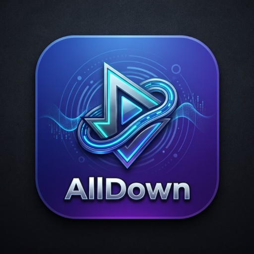

<div align="center">
  
  <h1>AllDown</h1>
  <p><b>Universal Media Downloader & Built-in Video / HD GIF Studio for Android</b></p>

  <p>
    <a href="https://github.com/vugy0212/Alldown/releases"></a>
    <a href="https://flutter.dev"></a>
    <a href="https://developer.android.com"></a>
    <a href="LICENSE"></a>
  </p>

  <p>
    <b>Author:</b> Allen &nbsp;•&nbsp;
    <a href="#-key-features">Features</a> &nbsp;•&nbsp;
    <a href="#-supported-platforms--services">Supported Services</a> &nbsp;•&nbsp;
    <a href="#%EF%B8%8F-video-studio--hd-gif-generator">Video & GIF Studio</a> &nbsp;•&nbsp;
    <a href="#-getting-started">Getting Started</a>
  </p>
</div>

---

## 📖 Overview

**AllDown** is a modern, fast, and privacy-focused Android application for downloading video and audio content from popular platforms, equipped with a built-in **Video Studio** for trimming, aspect-ratio cropping, interactive pan/zoom, and **HD Animated GIF creation**.

Designed with a sleek **Dark & Light Theme** interface, AllDown combines multi-stream extraction, a real-time Android Foreground Service queue, and hardware-accelerated Jetpack Media3 video processing in a single app.

---

## ✨ Key Features

- 🌐 **Multi-Platform Media Downloader**
  - Direct video (`.mp4`, `.webm`) and audio (`.m4a`, `.mp3`, `.wav`) extraction across major video portals, social networks, and direct CDNs.
  - Real-time metadata resolution (video title, channel/author, duration, thumbnail, and available stream qualities).
- 🎬 **Built-in Video Crop, Zoom & Trim Studio**
  - Frame-accurate start and end time trimming.
  - Aspect ratio presets (`Original`, `16:9`, `9:16`, `1:1`, `4:5`) for Reels, TikTok, Shorts, and YouTube.
  - Interactive **Zoom (`1.0x` – `3.0x`)** and touch-drag **Pan (X / Y)** directly over the live video preview.
  - Hardware-accelerated MP4 export powered by **Android Jetpack Media3 Transformer**.
- 🖼️ **HD Animated GIF Studio (True 256-Color Palette)**
  - Convert any video clip into a crisp animated GIF (`10 FPS`, 480p HD).
  - Uses **Median-Cut Color Quantization** + **Floyd-Steinberg Dithering** for smooth gradients without color banding.
  - Automatic `MediaScannerConnection` indexing directly into the Android / Samsung Gallery (`Movies/AllDown` & `Pictures/AllDown`).
- ⚡ **Smart Queue & Background Service**
  - Parallel download pipeline (configurable `1` – `5` simultaneous streams) with real-time speed (`MB/s`), progress bar, and ETA in Android notifications.
  - Supports **Wi-Fi Only** protection, **Auto-Retry on Failure**, custom **User-Agent** profiles, configurable connection timeouts, and Netscape **`cookies.txt`** import.
- 🎨 **Dynamic Dark & Light Mode**
  - Instant theme switching right from the top header bar with persistent settings storage.

---

## 🌍 Supported Platforms & Services

AllDown resolves and downloads media across **12+ categories and platforms**:

| Platform / Service | Extraction Method & Capabilities | Status |
| :--- | :--- | :---: |
| **YouTube & YouTube Shorts** | Native stream manifest via `youtube_explode_dart` (Muxed MP4 & Audio-only M4A/WebM) | ✅ **Active** |
| **X (Twitter)** | Direct MP4 resolution (`1080p` / `720p` / `480p`) via `api.fxtwitter.com` | ✅ **Active** |
| **TikTok** | Watermark-free HD MP4 & metadata resolution via `tikwm.com` API | ✅ **Active** |
| **Facebook Watch & Reels** | Direct HD/SD stream scraping (`hd_src` / `sd_src` / OpenGraph) | ✅ **Active** |
| **Streamable** | Direct API JSON extraction (`api.streamable.com/videos`) | ✅ **Active** |
| **Wikimedia Commons** | Open-source HD video & audio archives | ✅ **Active** |
| **Internet Archive (`archive.org`)** | Public domain films, documentaries & audio collections | ✅ **Active** |
| **Blender Open Movies CDN** | High-bitrate cinema test streams (Sintel, Big Buck Bunny, Tears of Steel) | ✅ **Active** |
| **Dailymotion & Vimeo** | OpenGraph `og:video` & embedded HTML5 media extractor | ✅ **Active** |
| **GitHub Raw & Release Assets** | Direct repository media files | ✅ **Active** |
| **HTML5 `<video>` Portals** | Automatic `<video>` and `<source>` tag stream discovery | ✅ **Active** |
| **Universal Direct Links** | Any direct `.mp4`, `.webm`, `.mkv`, `.m4a`, `.mp3`, `.wav`, `.ogg` URL | ✅ **Active** |

> **Privacy & Third-Party Resolution Note:** AllDown runs locally on your device without any tracking or analytics servers. For X/Twitter and TikTok links, public post URLs are resolved via public endpoints (`api.fxtwitter.com` and `tikwm.com`).

---

## ✂️ Video Studio & HD GIF Generator

AllDown includes a complete media post-processing studio without requiring external editing apps:

```
┌────────────────────────────────────────────────────────┐
│                  ALLDOWN VIDEO STUDIO                  │
├────────────────────────────────────────────────────────┤
│  [ Trim Slider ]  ──[==================]──  00:15 / 00:30│
│                                                        │
│  [ Aspect Ratios ]                                     │
│  (•) Original   ( ) 16:9    ( ) 9:16    ( ) 1:1   4:5  │
│                                                        │
│  [ Zoom & Pan Framing ]                                │
│  (-) ──────────[ 1.4x ]────────── (+)                  │
│  Pan X: [-1.0 ... 0.0 ... +1.0]                        │
│  Pan Y: [-1.0 ... 0.0 ... +1.0]                        │
│  (Supports interactive drag directly on video canvas)  │
│                                                        │
│  [ SAVE VIDEO (MP4) ]           [ CREATE GIF (HD) ]    │
└────────────────────────────────────────────────────────┘
```

---

## 🛠️ Tech Stack

- **Framework:** [Flutter](https://flutter.dev) (Dart 3.x)
- **State Management:** [Riverpod](https://riverpod.dev) 2.x (`StateNotifierProvider`)
- **Native Android Video Engine:** Jetpack Media3 (`media3-transformer`, `media3-effect`, `media3-common` 1.4.1)
- **Custom Native GIF Encoder:** Kotlin `AnimatedGifEncoder` with Median-Cut 256-color quantizer & Floyd-Steinberg dithering
- **Background Execution:** Android `DownloadForegroundService` (`foregroundServiceType="dataSync"`) + `FileProvider`
- **Storage & Gallery Sync:** `SharedPreferences`, Android Scoped Storage & `MediaScannerConnection`

---

## 🚀 Getting Started

### Prerequisites
- [Flutter SDK](https://docs.flutter.dev/get-started/install) (3.22+ / Dart 3.x)
- Android SDK (API 26+ / Android 8.0 Oreo or newer)
- Java 17 (OpenJDK)

### 1. Clone the Repository
```bash
git clone https://github.com/vugy0212/Alldown.git
cd Alldown/alldown
```

### 2. Install Dependencies
```bash
flutter pub get
```

### 3. Run Static Analysis & Tests
```bash
flutter analyze
flutter test test/widget_test.dart
```

### 4. Build & Install APK
```bash
# Debug build
flutter build apk --debug
adb install -r build/app/outputs/flutter-apk/app-debug.apk

# Release build (uses key.properties if present, or debug signing fallback)
flutter build apk --release
```

### 5. Production Release Signing (Optional)
To sign a production release APK with your own Android keystore:
1. Copy [`alldown/android/key.properties.example`](alldown/android/key.properties.example) to `alldown/android/key.properties` (automatically ignored by Git).
2. Fill in your `storeFile`, `storePassword`, `keyAlias`, and `keyPassword`.

---

## 👤 About

- **Project:** AllDown
- **Version:** 1.0.1 (`v1.0.1+2`)
- **Author:** **Allen**
- **Repository:** [https://github.com/vugy0212/Alldown](https://github.com/vugy0212/Alldown)

---

## 🙏 Credits & Acknowledgements

AllDown is developed as an independent, modernized Flutter media application built upon the architectural foundations, concepts, and heritage of [Seal](https://github.com/JunkFood02/Seal) by [JunkFood02](https://github.com/JunkFood02). We express our sincere gratitude to JunkFood02 and the open-source multimedia community (`yt-dlp`, FFmpeg, Media3) for their invaluable pioneer work and inspiration.

---

## 📄 License

This project is open-source software licensed under the [GNU General Public License v3.0 (GPLv3)](LICENSE).
